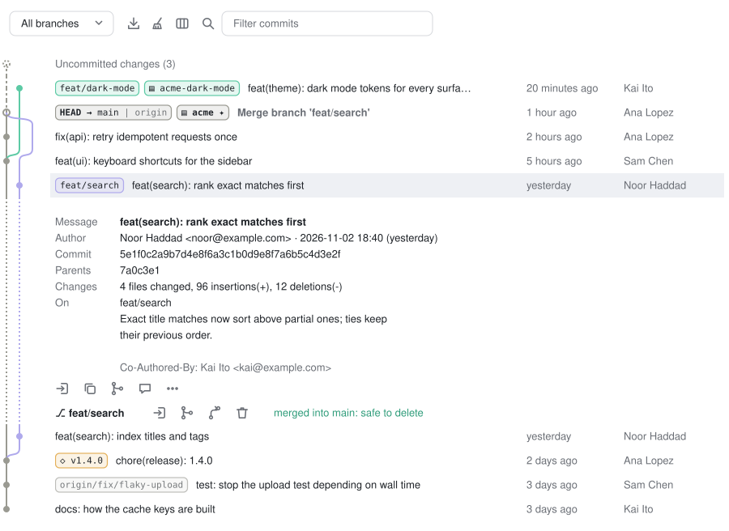

# Git Graph for Claude Code

[](https://github.com/owlcode/claude-git-graph/actions/workflows/ci.yml)
[](https://github.com/owlcode/claude-git-graph/releases)
[](LICENSE)

A Claude Code mod that puts a **Git Graph** pane beside the chat: the commit graph in coloured lanes, every branch, tag and **worktree** on its commit, and the everyday git actions (checkout, merge, rebase, delete, clean up) one click from the graph. When several Claude sessions work in parallel worktrees, you see where each one is.

<picture>
  <source media="(prefers-color-scheme: dark)" srcset="docs/preview-dark.svg">
  
</picture>

<sub>Drawn by the mod's own lane, chip and icon code over a made-up history (`pnpm preview`).</sub>

## Install

Needs Claude Code 2.1.275 or later. At the prompt of a terminal session:

```
/plugin install git-graph --marketplace owlcode/claude-git-graph
```

Answer `y` to add the marketplace, then pick a scope (user scope loads it in every session).

From a shell:

```bash
claude plugin install git-graph --marketplace owlcode/claude-git-graph
```

In the desktop app, where `/plugin` does not run: click **+** next to the prompt box, then **Plugins**, **Add marketplace** with `owlcode/claude-git-graph`, then **Add plugin**. A mod installed from a terminal at the user scope loads in the desktop app's sessions too.

## Use it

Run `/gitgraph`, or press **⎇ Git graph** in the band above the prompt. The band also shows the session's branch, `↑N ↓M` against its upstream, `clean` / `N changed` and the worktree count.

- **The graph.** One colour per lane, curved fork and merge lines, and chips for every branch, remote branch, tag and worktree on a commit (`▤ name`, `✦` for the session's own worktree, a dim `▤ name ⤴` where a worktree's branch left the default branch). Hover the chips for a card that names each one in full and says what it is.
- **Columns.** Graph, Description, Date, Author and Commit. The **columns** icon shows or hides them; drag the edge between two columns (it lights up `┃`) to resize. The graph column clips its lanes, so 50 parallel branches never push the text off screen.
- **Toolbar.** *All branches / Current branch*, then bare icons: **Pull & Fetch** (`git fetch --all --prune`, then `git pull --ff-only` only when this worktree is clean and has an upstream), **Clean up**, **Columns**, and a filter (subject, author, hash). Hover an icon and its description shows in the line under the toolbar. The pane refreshes by itself: every 5 seconds and after each `Bash` call.
- **Click a commit** to unfold it: the full message (trailers dimmed), author and committer with e-mail and date, the full hash, parents, what it changed, and where it is. Icons below it: check out (detached), copy the hash, merge it into the current branch, ask Claude about it, and the full actions menu.
- **Per branch on an unfolded commit:** check out, merge into the current branch, rebase the current branch onto it, delete. Once the commit is in the default branch the row says *merged into main: safe to delete*.
- **Right-click** a row for a menu with every action for that commit, its branches, remote branches, tags and worktrees.

On the terminal the lanes fall back to ASCII (`│ ● ─ ┘`) and the icons to labelled buttons.

## What it changes, and how carefully

The pane reads freely and writes only when you press something. Every git command runs through Claude Code's `$.process.run`, with the repository's git hooks off.

| Action | What runs | Guard |
| --- | --- | --- |
| Check out a branch | `git switch <branch>` (a remote-only one: `git switch --track <remote>/<branch>`) | With changes here it asks first and offers `git stash push -u`, popped back if the switch fails. A branch another worktree has checked out cannot be switched to, so its icon copies `cd <that worktree>` instead. |
| Check out a commit | `git switch --detach <hash>` | Always asks first. |
| Merge | `git merge --no-edit <ref>` in the session's worktree | Refused while that worktree has changes; on conflicts offers `git merge --abort`. |
| Rebase | `git rebase <onto>` | Asks first, keeps the old tip as `refs/git-graph/backup/<branch>`, refused with changes, offers `git rebase --abort`. A branch no worktree has is rebased in a temporary worktree, so your checkout never moves. |
| Delete a branch | `git branch -d`, and `git push <remote> --delete` only when you tick it | Asks first; never `-D`, so git refuses an unmerged or checked-out branch. |
| Pull & Fetch | `git fetch --all --prune`, then `git pull --ff-only` | Never merges or rebases; skips the pull with changes here. |
| Clean up | `git worktree prune`, `git worktree remove`, `git branch -d` | Shows the plan first, each row can be switched off, nothing runs until you press **Remove N**, stops at the first failure. |

Nothing is ever forced: no `--force`, `-f` or `-D` anywhere.

### Clean up

The base branch is `origin/HEAD`'s branch, else `main`, else `master`. The plan lists stale worktrees (folder gone), worktrees whose branch is merged into the base (never the main worktree or the session's own, and only when clean and unlocked), and merged local branches no worktree has checked out (never the base or the current branch). Dirty or locked worktrees are listed as skipped, with the reason. Worktrees under `.claude/worktrees/` are tagged `agent`.

## Limits

- The desktop draws nothing for a pane over 256 KB, so the pane shows as many commits as fit under that (a hundred and more) and then says so instead of offering **Load more**; filter to find older ones.
- The mod API cannot change the mouse cursor, so a column edge lights up instead.
- The plugin is named `git-graph`: Claude Code reserves the `claude-` prefix for plugin names.

## Develop

```bash
git clone https://github.com/owlcode/claude-git-graph && cd claude-git-graph
pnpm install
claude --plugin-dir .   # this session loads the mod from the folder and reloads it on save
```

For sessions you cannot pass a flag to (such as the desktop app), name the folder in `CLAUDE_CODE_PLUGIN_DIRS`.

```bash
pnpm validate    # claude plugin validate .
pnpm test        # claude plugin test .
pnpm typecheck   # tsc -p . (needs the types Claude Code writes to .claude-plugin/types/ once it has loaded the mod)
pnpm preview     # redraws docs/preview-*.svg (needs bun)
```

Layout: `hooks/register.tsx` is the mod (pane, band, command, actions); `hooks/git/` holds the pure parts (log parsing, graph layout, chips, clean-up planning), each with its tests; `hooks/row.tsx`, `hooks/icon.tsx` and `hooks/resize.tsx` are the client modules that read the pointer. CI runs validate and test on every push; a `v*` tag publishes a release with a `.plugin` archive.

## License

[MIT](LICENSE)
